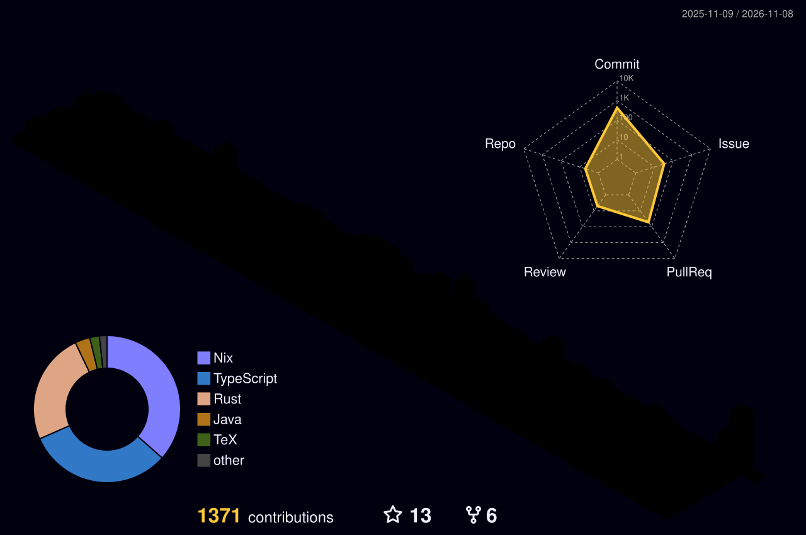

# 👋 Hey there, I'm Marcel!

My programming journey started at age 13, and I’ve been building projects ever since.

👔 Engineer @ Trainline \
🎒 Computer Science Graduate @ City St George's University \
📝 Hobbyist Rust Developer

## 🧰 Core Tools:

- C#
- Rust
- Java
- C++
- TypeScript

## Hobbies

🕹️ Games \
🔍 Learning \
🧗🏼‍♂️ Bouldering \
🎸 Guitar \
🏞️ Travel

## My stats...

 
